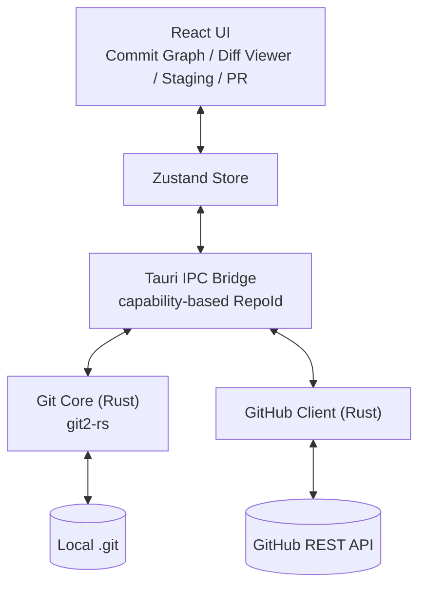

# Kira

[](https://tauri.app/)
[](https://www.rust-lang.org/)
[](https://react.dev/)
[](LICENSE)

[English](README_EN.md)

把 git repo 變成可以好好看的東西。

「Kira」取自日文「綺麗（kirei）」——意指漂亮、整齊、令人想多看一眼。我想做的是一款最美的 Git 觀看工具：commit 歷史不再是密密麻麻的文字 log，diff 不再是難讀的 +/− 行海，branch 拓撲一眼就能跟上。

---

## 為什麼做這個

市面上的 Git GUI 多半從「功能完整度」出發——能做的事很多，但介面像一張塞滿按鈕的儀表板。我用過很多年，每次看 commit graph 都覺得：明明 git 內部有那麼漂亮的拓撲結構，為什麼工具總是把它畫得像 Excel？

Kira 反過來想：**先把「好看、好讀」做到位，再談功能。** 觀看是最高頻的 git 動作——讀 log、追 branch、看 diff、檢查 PR——這些動作的視覺體驗應該是愉快的，不是負擔。

---

## 核心理念

| 主軸 | 做法 |
|------|------|
| **觀看為先** | Commit Graph 是 Kira 的主畫面，不是側邊欄 |
| **顏色貫穿** | 同一個 branch 在 graph、diff、PR 面板都用同色，視線不需要重新對焦 |
| **動畫是資訊** | 只在狀態真的變化時動——面板進場、hover 回饋。離場刻意不做動畫，因為離開本身不傳遞任何資訊 |
| **少即是多** | 進階 git 操作（rebase、cherry-pick、bisect）目前不在 MVP 範圍——先把基本動作做對 |

---

## 現況

開發階段：**Pre-MVP**，後端 git core 已就位，前端 UI 進行中。

| 模組 | 狀態 |
|------|------|
| Tauri + React + TS 鷹架 | ✅ |
| Rust 後端 git core（open / graph / diff / status / stage / unstage / commit） | ✅ |
| IPC capability（RepoId 取代任意路徑、per-repo write lock） | ✅ |
| Commit Graph 渲染（路線圖：HTML 列 + SVG 路線層） | ✅ |
| Staging Area UI | ✅ |
| Push / Pull + transfer progress 事件 | ✅ |
| Diff Viewer（語法高亮、binary / 大檔 / 檔數上限保護） | ✅ |
| GitHub OAuth Device Flow（keyring 儲存 + cred allowlist） | ✅ |
| Branch 操作（checkout / create / delete） | ✅ |
| Clone Modal + Recent Repos Sidebar | ✅ |
| PR 面板（列表 + diff + review/CI badge） | ✅ |
| 自動重刷（file watcher 偵測外部 git 變更） | ✅ |
| 安全護欄（unstaged cap / dirty-check / enrichment throttle / 路線圖的交叉與訊息長度上限） | ✅ |
| 視覺打磨（共用 UI 元件 + Graph 重繪 + light / dark 雙 theme 校準） | ✅ |
| v8 設計移植（殼層、路線圖完成；側欄 / 右欄 / diff、對話框接著做） | 🚧 |

詳細任務拆分見 [`docs/PLAN.md`](docs/PLAN.md)，IPC 規格見 [`docs/SPEC.md`](docs/SPEC.md)，使用者故事見 [`docs/PRD.md`](docs/PRD.md)。

---

## 系統架構



IPC 採 **capability-based** 設計：路徑只能從兩個地方進來——Rust 端的原生檔案選擇器（開 repo、選 clone 目的地），或已經存在近期清單裡的路徑（`git_open_recent_repo` 只收清單裡有的）。webview 沒辦法直接塞任意路徑給後端；其餘指令只接受不可預測的 `repo_id`，後端從受信任的 registry 反查路徑。Mutating 指令在後端取 per-repo write lock，避免 index 並發競爭。

---

## 技術棧

| 層 | 技術 | 版本 |
|------|------|------|
| Desktop 框架 | Tauri | 2 |
| 前端框架 | React + TypeScript | 18 / 5.6 |
| UI 樣式 | v8 設計基準 CSS + Tailwind CSS（移植過渡期） | — / 4 |
| Graph 渲染 | React + SVG | — |
| 動畫 | CSS transitions + @keyframes | — |
| 狀態管理 | Zustand | 5 |
| 建構工具 | Vite | 5 |
| 測試 | Vitest / cargo test | — |
| Git 操作 | git2-rs | 0.19 |
| Token ID | nanoid | 0.4 |
| 錯誤處理 | thiserror | 1 |

---

## 快速開始

### 環境需求

- Node.js 20+
- Rust stable（`rustup install stable`）
- 系統依賴：vendored libgit2 與 openssl 已內建到 Cargo profile，首次編譯需 5+ 分鐘（CI 已加 cache）

### 開發

```bash
# 安裝前端依賴
npm install

# 啟動 Tauri 開發模式（Rust 後端 + Vite HMR 前端）
npm run dev

# 只啟動前端（純 UI 開發）
npm run dev:renderer
```

### 測試

```bash
# 後端 Rust 測試
cd src-tauri && cargo test

# 前端 Vitest
npm test

# Lint / 格式
cargo clippy --all-targets -- -D warnings
cargo fmt --check
npm run lint
```

### 建構

```bash
npm run build              # 前端 production build
cargo tauri build          # 完整桌面 app 打包
```

---

## 專案結構

```
kira/
├── src/                          # React 前端
│   ├── components/               # Graph / DiffViewer / StagingArea / PRPanel / BranchList / CloneRepo / ThemeSwitcher
│   ├── stores/                   # Zustand stores（repo / graph / push-pull 等）
│   ├── lib/                      # tauri.ts IPC wrapper、共用工具
│   ├── styles/                   # v8 設計基準的 CSS 與圖示 sprite（腳本同步的逐字副本，不手改）
│   ├── tests/                    # Vitest 單元測試 + RTL 元件測試
│   └── App.tsx / main.tsx
├── src-tauri/                    # Rust 後端
│   ├── src/
│   │   ├── commands/git.rs       # Tauri IPC 指令層（thin wrapper）
│   │   ├── git/
│   │   │   ├── graph.rs          # Commit graph 計算
│   │   │   ├── diff.rs           # Diff 與 working-tree status
│   │   │   ├── stage.rs          # Stage / Unstage / Commit 邏輯
│   │   │   ├── remote.rs         # Push / Pull / Fetch + transfer progress
│   │   │   ├── branch.rs        # Branch CRUD + checkout
│   │   │   └── clone.rs         # Clone engine + progress events
│   │   ├── github/
│   │   │   ├── auth.rs           # OAuth Device Flow + keyring
│   │   │   ├── pr.rs             # PR list + review/CI enrichment
│   │   │   └── patch_parser.rs   # Unified diff → FileDiff[]
│   │   ├── fs/
│   │   │   ├── recent_repos.rs   # Recent repos JSON persistence
│   │   │   └── watcher.rs        # File-system watcher（外部變更自動重刷）
│   │   ├── state.rs              # RepoRegistry + per-repo write lock
│   │   ├── error.rs              # KiraError + IPC 序列化遮蔽
│   │   └── lib.rs                # Tauri builder + state manage
│   ├── Cargo.toml
│   └── tauri.conf.json
├── docs/
│   ├── PRD.md                    # 使用者故事與驗收標準
│   ├── SPEC.md                   # 系統架構與 IPC schema
│   └── PLAN.md                   # Task 拆分與實作順序
├── README.md                     # 中文版（你正在看）
└── README_EN.md                  # English version
```

---

## 我們不做什麼（Non-goals）

- **進階 git 操作**：rebase、cherry-pick、bisect、reflog 修復——這些在 CLI 已經很順手，GUI 化收益有限。Kira 專注在「觀看 + 基本協作」。
- **取代 git CLI**：terminal 永遠在那裡。Kira 不嘗試用 GUI 包裝所有 CLI 子指令。
- **支援所有 hosting 服務**：第一階段只接 GitHub。GitLab / Bitbucket / Gitea 看社群需求再說。
- **CLI 模式**：Kira 是 desktop GUI，不做 headless 版本。觀看的價值就是 GUI。

---

## 設計抉擇

- **Tauri 而非 Electron**：bundle size 從動輒 100 MB+ 砍到個位數 MB，記憶體占用差一個數量級。代價是要寫 Rust——不過 Rust 處理 git2-rs 比 Node.js wrapper 直接太多。
- **git2-rs 而非 shell out git CLI**：避開「user PATH 有沒有 git、版本對不對、locale 影響輸出格式」三大不穩定來源。代價是 libgit2 是同步 API，而 Tauri 的同步 command 跑在主執行緒，重活會讓畫面卡住。diff 已經改成 async command，丟到 thread pool 去算，一次送到畫面的量也設了上限（超過的檔整檔收合，只列檔名與大小）；push / pull 還是同步 command，改成 async 排在後續工作。
- **Capability-based IPC**：路徑只從 Rust 端的原生檔案選擇器或近期清單進來，其他指令一律收 token。最早有 7 個指令都直接收路徑，現在信任邊界只剩這幾個入口，而且沒有一個讓 webview 自己決定路徑。
- **不引入 Redux**：Zustand 對 desktop app 的狀態量級剛好，不需要 Redux 的儀式感。

---

## 隨想

AI 越來越會幫你寫 git command，像是 commit message、rebase 指令、merge conflict。執行這一側 AI 都能代勞。但另一邊不一樣。git 的拓撲、分支關係、為什麼這個 commit 變成 ancestor、為什麼這個 rebase 會丟東西，這些是「理解」，必須自己看、自己建立心智模型。

執行可以外包，理解不能。

這條也順便補上面 Non-goals 沒講清楚的：寫「CLI 已經很順手」其實不夠精確，commit / push / pull 在 CLI 也很順手，但 Kira 還是做。切割線是「執行 vs 理解」。rebase / cherry-pick / bisect 是執行（AI 能寫、CLI 能跑），commit graph / diff / branch 拓撲是理解（必須自己看）。Kira 把資源全押在「理解」這一側。

Kira 補的是 CLI 給不全、AI 給了，但我們人類還是不能理解，或是企圖了解的那一塊。一個視覺化場域，讓你自己看見 git 在做什麼，自己學會。

---

另一件事：上面花很多篇幅談架構（Tauri、git2-rs、capability IPC、Zustand），但 Kira 對外講「美」。從外面看像錯位，但對我來說是同一件事。架構乾淨跟視覺乾淨，是同一條紀律的兩個面向，都是「這裡可以糊弄但我不要」。願意花心思讓 commit graph 好看的人，不會接受 IPC 層的安全 hack；願意收斂 capability 邊界的人，也不會接受 diff viewer 顏色刺眼。

「最美」這件事是給我自己看的標準，不是拿來跟誰比的。我不會跟 Fork 或 GitKraken 比哪裡美，但會跟昨天的自己比。

---

## 授權

程式碼以 [Apache License 2.0](LICENSE) 授權。

「Kira」名稱與圖示（`src-tauri/icons/` 裡的 app 圖示與原始檔）不在授權範圍內，保留所有權利。fork 或改作的版本，請換用自己的名稱與圖示。

---

## 作者

tznthou — [service@tznthou.com](mailto:service@tznthou.com) · [tznthou.com](https://tznthou.com)
