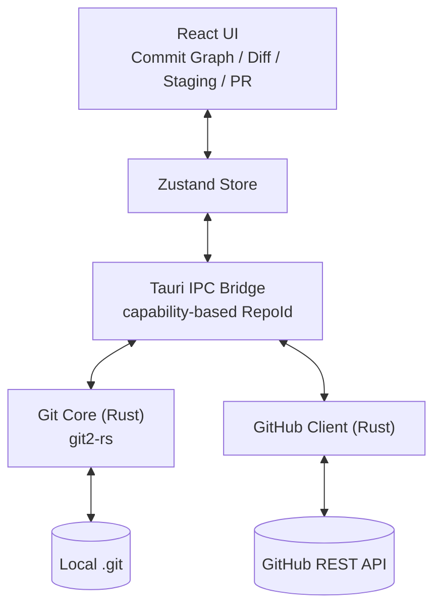

# Kira

[](https://tauri.app/)
[](https://www.rust-lang.org/)
[](https://react.dev/)
[](LICENSE)

[中文](README.md)

A Git client built around looking — not just doing.

The name **Kira** comes from the Japanese word *kirei* (綺麗) — clean, neat, the kind of thing you don't mind staring at. That's the whole pitch: make a Git client whose primary sense is sight. Commit history shouldn't read like a wall of hashes. Diffs shouldn't make your eyes glaze over. Branch topology should land in your head the moment you look at it.

---

## Why this exists

Most Git GUIs optimize for surface area — how many commands they can wrap, how many panels they can stack. They feel like dashboards. Meanwhile the actual data structure underneath Git is genuinely beautiful (a colored DAG of authored deltas), and almost no client renders it that way.

Kira flips the priority: **looking comes first.** Reading log, following a branch, scanning a diff, reviewing a PR — these are the things you do every day. The visual experience there should be a small pleasure, not a tax you pay to find what you need.

---

## What it cares about

| Theme | Means in practice |
|------|------|
| **Viewing first** | The Commit Graph is the main canvas, not a side panel |
| **Color carries meaning** | A branch keeps the same color in graph, diff, and PR view — your eyes don't have to re-orient |
| **Animation as information** | Motion only where state actually changes — panel entry, hover feedback. Exits stay static on purpose: leaving tells you nothing |
| **Less surface, more polish** | History rewriting (rebase, cherry-pick, bisect) isn't on the MVP path. Get the basics beautiful first |

---

## Where it is right now

Status: **pre-MVP**. The Rust git core is in place; the UI is being built.

| Area | State |
|------|------|
| Tauri + React + TS scaffolding | ✅ |
| Rust git core (open / graph / diff / status / stage / unstage / commit) | ✅ |
| IPC capability model (RepoId tokens replace raw paths, per-repo write lock) | ✅ |
| Commit Graph rendering (route map: HTML rows + SVG route layer) | ✅ |
| Staging Area UI | ✅ |
| Push / Pull with transfer-progress events | ✅ |
| Diff Viewer (syntax highlighting, binary / oversize / file-count guards) | ✅ |
| GitHub OAuth Device Flow (keyring storage + cred allowlist) | ✅ |
| Branch operations (checkout / create / delete) | ✅ |
| Clone Modal + Recent Repos Sidebar | ✅ |
| PR panel (list + diff + review/CI badges) | ✅ |
| Auto-refresh (file watcher detects external git changes) | ✅ |
| Safety rails (unstaged cap / dirty-check / enrichment throttle / route-map budgets for crossings and subject length) | ✅ |
| Visual polish (shared UI components + graph redesign + light / dark dual-theme parity) | ✅ |
| v8 design port (shell and route map done; sidebar / right pane / diff and the dialogs next) | 🚧 |

Task breakdown: [`docs/PLAN.md`](docs/PLAN.md). IPC schema: [`docs/SPEC.md`](docs/SPEC.md). User stories: [`docs/PRD.md`](docs/PRD.md).

---

## Architecture



The IPC layer is **capability-based**. A path gets in only two ways: through the native file picker on the Rust side (opening a repo, choosing where to clone), or from the recent-repos list (`git_open_recent_repo` accepts only paths already stored there). The webview can't hand the backend an arbitrary path. Everything else accepts an opaque `repo_id`, and the backend resolves the path from a trusted registry. Mutating commands take a per-repo write lock so concurrent stage/unstage/commit calls don't race on the index.

---

## Stack

| Layer | Tech | Version |
|------|------|------|
| Desktop shell | Tauri | 2 |
| Frontend | React + TypeScript | 18 / 5.6 |
| Styling | v8 design-reference CSS + Tailwind CSS (while the port is underway) | — / 4 |
| Graph rendering | React + SVG | — |
| Animation | CSS transitions + @keyframes | — |
| State | Zustand | 5 |
| Build | Vite | 5 |
| Test | Vitest / cargo test | — |
| Git ops | git2-rs | 0.19 |
| Token IDs | nanoid | 0.4 |
| Errors | thiserror | 1 |

---

## Getting started

### Requirements

- Node.js 20+
- Rust stable (`rustup install stable`)
- libgit2 and openssl are vendored into the Cargo profile, so the first build takes 5+ minutes. Subsequent builds use Cargo's cache.

### Develop

```bash
# Install frontend deps
npm install

# Run Tauri in dev mode (Rust backend + Vite HMR)
npm run dev

# Or just the frontend (UI-only iteration)
npm run dev:renderer
```

### Test

```bash
cd src-tauri && cargo test       # Rust backend
npm test                         # Vitest (frontend)
cargo clippy --all-targets -- -D warnings
cargo fmt --check
npm run lint
```

### Build

```bash
npm run build                    # Frontend production build
cargo tauri build                # Full desktop bundle
```

---

## Layout

```
kira/
├── src/                          # React frontend
│   ├── components/               # Graph, DiffViewer, StagingArea, PRPanel, BranchList, CloneRepo, ThemeSwitcher
│   ├── stores/                   # Zustand stores (repo, graph, push-pull, ...)
│   ├── lib/                      # tauri.ts IPC wrapper, shared utilities
│   ├── styles/                   # v8 design-reference CSS and icon sprite (verbatim copies synced by a script; never hand-edited)
│   ├── tests/                    # Vitest unit tests + RTL component tests
│   └── App.tsx / main.tsx
├── src-tauri/                    # Rust backend
│   ├── src/
│   │   ├── commands/git.rs       # Tauri IPC entry layer (thin wrappers)
│   │   ├── git/
│   │   │   ├── graph.rs          # Commit graph computation
│   │   │   ├── diff.rs           # Diff + working-tree status
│   │   │   ├── stage.rs          # Stage / unstage / commit logic
│   │   │   ├── remote.rs         # Push / pull / fetch + transfer progress
│   │   │   ├── branch.rs        # Branch CRUD + checkout
│   │   │   └── clone.rs         # Clone engine + progress events
│   │   ├── github/
│   │   │   ├── auth.rs           # OAuth Device Flow + keyring
│   │   │   ├── pr.rs             # PR list + review/CI enrichment
│   │   │   └── patch_parser.rs   # Unified diff → FileDiff[]
│   │   ├── fs/
│   │   │   ├── recent_repos.rs   # Recent repos JSON persistence
│   │   │   └── watcher.rs        # File-system watcher (auto-refresh on external changes)
│   │   ├── state.rs              # RepoRegistry + per-repo write lock
│   │   ├── error.rs              # KiraError + IPC redaction
│   │   └── lib.rs                # Tauri builder + state management
│   ├── Cargo.toml
│   └── tauri.conf.json
├── docs/
│   ├── PRD.md                    # User stories and acceptance criteria
│   ├── SPEC.md                   # Architecture + IPC schema
│   └── PLAN.md                   # Task plan and build order
├── README.md                     # 中文版
└── README_EN.md                  # English (you're reading this)
```

---

## Non-goals

- **History rewriting in the GUI.** Rebase, cherry-pick, bisect, reflog surgery — they work fine in the CLI, and dressing them up in a GUI tends to hide the surface area you actually need to see. Kira sticks to viewing and routine collaboration.
- **Replacing the CLI.** The terminal isn't going anywhere. Kira doesn't try to wrap every Git subcommand into a button.
- **Every hosting service on day one.** GitHub first. GitLab / Bitbucket / Gitea depend on real demand, not aspiration.
- **A headless / CLI mode.** Kira is a desktop GUI. The whole point is what you see; running it without a window would defeat the premise.

---

## Design choices worth calling out

- **Tauri over Electron.** Bundle size drops from 100+ MB to single digits, and memory usage is roughly an order of magnitude lower. The trade is Rust on the backend — which turns out to be a feature when you're calling git2-rs directly instead of marshalling through a Node wrapper.
- **git2-rs, not shelling out to git.** Calling the Git CLI introduces three flaky variables: which `git` is on PATH, which version, and what locale formats the output. libgit2 sidesteps all three. The price is that it's a sync API, and Tauri runs sync commands on the main thread, where a heavy job freezes the window. Diffs are off it now: they run as an async command on the thread pool, and how much of a diff reaches the screen is capped (a file over the cap is collapsed to its name and size). Push / pull are still sync commands; moving them to async is queued up as follow-up work.
- **Capability-based IPC.** Paths come in only through the Rust-side native picker or the stored recent list; every other command takes a token. Seven commands used to accept raw paths. Now the trust boundary is a handful of entry points, and none of them lets the webview pick the path.
- **Zustand instead of Redux.** Desktop-app state isn't large enough to justify Redux's ceremony. Zustand is enough.

---

## Reflections

AI is getting better and better at the "doing" side of Git — writing commit messages, suggesting rebase sequences, resolving merge conflicts. That side is being commoditized fast.

But there's another side. Why this commit ended up an ancestor of that one. Why a particular rebase quietly dropped a change. How branches actually relate to each other. These aren't things you can outsource — you have to see them, build the model yourself.

Execution can be delegated. Understanding can't.

That distinction also clarifies a fuzzy line in the Non-goals above. "Works fine in the CLI" isn't quite the right standard — `commit` / `push` / `pull` work fine in the CLI too, and Kira still bothers to render them. The real cut is execution versus understanding. Rebase, cherry-pick, bisect: execution. The CLI handles those, AI handles those. Commit graph, diff, branch topology, conflict shape: understanding. Those you have to look at yourself. Kira spends all of its surface area on the second category.

Not a replacement for the CLI, not a competitor to AI on the doing side. What Kira offers is a visual space where Git makes sense to your own eyes — somewhere you teach yourself.

---

A separate thought: most of the README above is about architecture — Tauri instead of Electron, git2-rs instead of shelling out, capability-based IPC, Zustand over Redux. From the outside that can read like a mismatch with a project that pitches itself on visual beauty.

It's the same thing from the inside. Clean architecture and a clean interface are two faces of one discipline. Both say "this part could be hacked together, and I'm not going to." The same instinct that cares whether the commit graph reads at a glance also refuses a sloppy IPC layer. The same instinct that narrows the capability boundary also refuses garish diff colors.

"The most beautiful" isn't a claim against anyone else's product. It's a private standard. I'm not competing with Fork or GitKraken on beauty — I'm competing with what I shipped yesterday.

---

## License

The code is licensed under the [Apache License 2.0](LICENSE).

The Kira name and icon (the app icons in `src-tauri/icons/`, including their source files) are not covered by this license; all rights are reserved. Forks and derivative works should use their own name and icon.

---

## Author

tznthou — [service@tznthou.com](mailto:service@tznthou.com) · [tznthou.com](https://tznthou.com)
